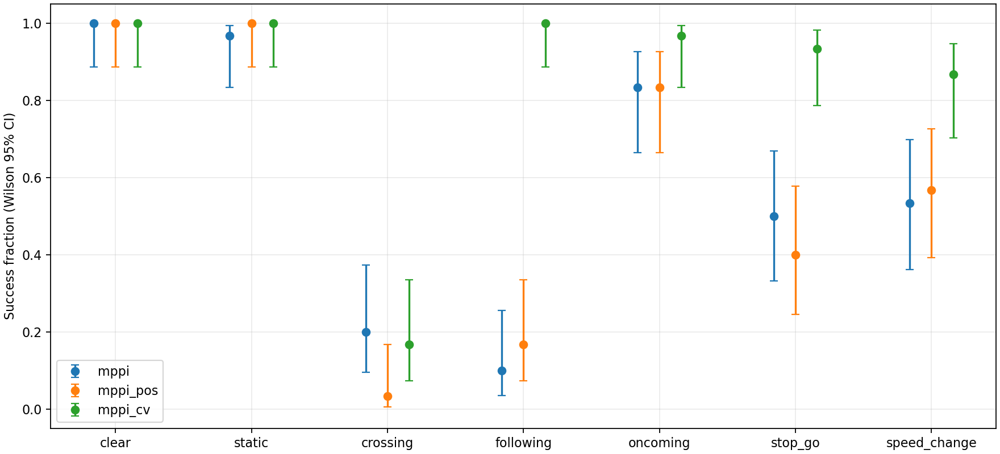
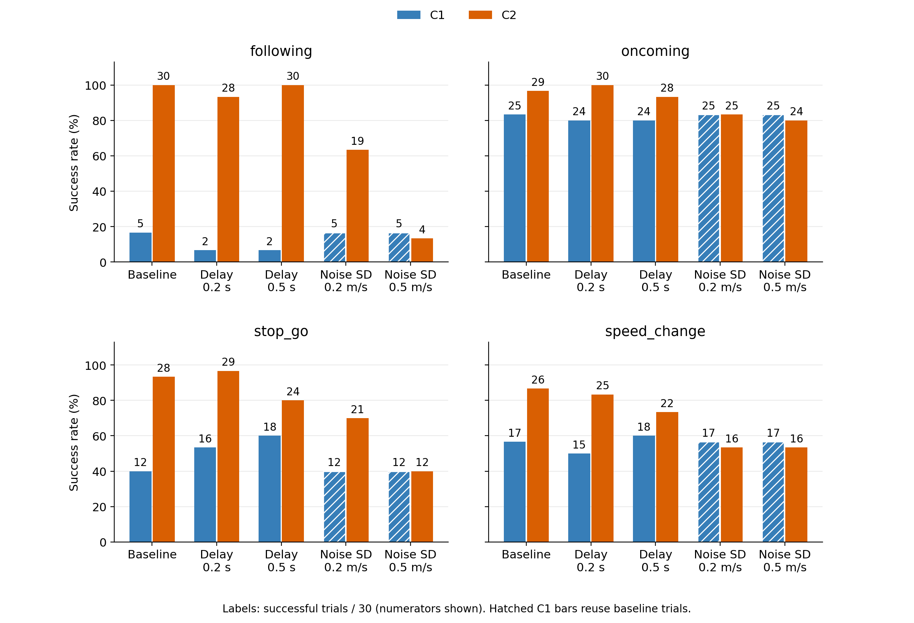

# oit_deliverybot_sim

ROS 2 / Gazebo experiments on the benefits and limits of LiDAR-estimated obstacle motion in Nav2 MPPI.
Includes a scan tracker, a custom MPPI critic, and repeatable closed-loop evaluation tools.

LiDARから推定した障害物の位置・速度を局所制御へ接続し、**動き情報が回避に役立つ条件と、追跡遅延・速度誤差・非等速運動による限界**を調べる卒業研究の開発成果です。
ROS 2 Jazzy / Gazebo Harmonic上で、仮想LiDAR、AMCL、Nav2、追跡器、MPPI critic、反復実行、記録・採点・統計比較までをまとめています。
等速予測criticの仕組み自体の新規性ではなく、速度利用の有無を揃えた比較と条件別の評価を研究対象としています。

**掲載結果は平坦通路での閉ループシミュレーションの結果です。実機性能や人物・多人数環境での安全性を示すものではありません。**

## 構成と比較方式

```text
Gazebo 仮想LiDAR → pointcloud_to_laserscan → LaserScan
                                             ├→ AMCL / Nav2 costmap
                                             └→ scan追跡器（観測時刻のTF・静的地図）
                                                 ↓ PointCloud2 [x, y, vx, vy, radius]
                                                 MPPI critic → 速度指令 → smoother → Gazebo
Gazebo 真値・接触情報 → 記録・採点（追跡器とcriticには入力しない）
```

追跡器は静的地図付近の点の除外、隣接点クラスタリング、円形近似、最近傍対応、等速Kalman filterを使います。
C++の追加criticは、候補軌道の各時刻における車体footprintと推定障害物円の距離からコストを計算します。

| 条件 | 起動時の `method` | 軌道評価 |
| --- | --- | --- |
| C0 | `mppi` | 標準Nav2 MPPI、共通costmapと既存critic |
| C1 | `mppi_pos` | C0＋追跡位置・半径を静止物として評価 |
| C2 | `mppi_cv` | C1と同じcriticで推定速度を使い等速予測 |

C1/C2は速度利用フラグ以外の追加critic設定を共通化します。主比較はC1対C2、副比較はC0対C2です。
C2には観測時刻から現在までの遅れの補償も含まれ、将来予測だけの寄与は分離していません。
全方式でcostmap、車体外形、速度上限、smootherを共通にし、追跡器も起動します。
標準ObstacleLayerにも観測を保持する仕組みがあるため、比較の差分は「動き情報の利用」です。

## 実験規模と主な結果

最終評価は、同梱の人工通路で **7場面 × 3方式 × 30 seed＝630条件**を実施しました。
開発seed 1〜5で設定を固定し、最終seed 10000〜10029を使用しました。
同じ場面・seedでは障害物条件を共有しますが、MPPI内部乱数や非同期実行のビット一致は保証しません。
衝突や走行失敗も分母に含め、初回の基盤異常10件とランナー停止1件だけを同条件で1回再実行して採用しています。

| 場面 | 内容 | C0 到達件数 | C1 到達件数 | C2 到達件数 |
| --- | --- | --- | --- | --- |
| `clear` | 障害物なし | 30/30 | 30/30 | 30/30 |
| `static` | 地図にない静止物 | 29/30 | 30/30 | 30/30 |
| `crossing` | 横切り | 6/30 | 1/30 | 5/30 |
| `following` | 同方向の低速物体 | 3/30 | 5/30 | 30/30 |
| `oncoming` | 横ずれのあるすれ違い | 25/30 | 25/30 | 29/30 |
| `stop_go` | 停止・再発進 | 15/30 | 12/30 | 28/30 |
| `speed_change` | 対向物体の減速 | 16/30 | 17/30 | 26/30 |



凡例の `mppi` / `mppi_pos` / `mppi_cv` はC0 / C1 / C2です。縦軸は到達割合、誤差棒は方式ごとのWilson 95%区間です。

- C1対C2では、`following`と`stop_go`の到達率増加・衝突率減少が有意でした（対応のある正確McNemar検定、比較方式×指標ごとの7場面でHolm補正、補正後p < 0.001）。
- `speed_change`と`oncoming`の到達件数は増えましたが、到達率の有意な差は認められませんでした（補正後p＝0.059、0.500）。`crossing`は全方式で大半が衝突しました。
- 到達時間の一貫した短縮や、不要な停止の減少は実証していません。障害物は単一円柱でロボットに反応せず、未知環境・複数物体への一般化は未検証です。

感度実験では基本結果に基づいて選んだ4場面に、追加遅延0.2 / 0.5 s、出力速度ノイズの各軸標準偏差0.2 / 0.5 m/sを個別に付加しました。
新規条件は遅延480＋ノイズ240＝**720条件**です。影響を受けないC0とノイズ条件のC1は基本行を再利用しており、追加の独立試行には数えません。
C2の`following`は基本30/30に対して速度ノイズ0.2 m/sで19/30、0.5 m/sで4/30となり、入力速度の信頼性に依存する限界が現れました。



棒上の数字は30件中の到達件数、斜線は基本行を再利用したC1です。遅延とノイズは同時に付加していません。
水準間の変化は記述統計であり、水準間の検定や方式の同等性を示すものではありません。
数値・既存図の出典は卒業論文第4章4.4・4.8節、第5章5.1〜5.3・5.7節、解釈は第6章です。論文本文は本リポジトリに含めていません。

## ビルド

Ubuntu 24.04、ROS 2 Jazzyを前提とします。Gazeboは[Jazzyに対応するHarmonic](https://gazebosim.org/docs/harmonic/ros_installation/)を使います。
Nav2（MPPIを含む）、ros_gz、pointcloud_to_laserscan、scenario_execution、MCAP、SciPy・NumPy・Matplotlibなどの依存は[package.xml](package.xml)に宣言しています。
実験時はNav2主要パッケージ1.3.11、lifecycle_manager 1.3.12、scenario_execution 1.4.0を使用しました。

ROS 2 Jazzyとrosdepのセットアップ後、次を実行します（rosdep初期化が未実施の場合だけ `sudo rosdep init` を先に実行）。

```bash
source /opt/ros/jazzy/setup.bash
mkdir -p ~/ros2_ws/src
cd ~/ros2_ws/src
git clone https://github.com/MK-svg773/oit_deliverybot_sim.git
cd ~/ros2_ws
rosdep update
rosdep install --from-paths src/oit_deliverybot_sim --ignore-src -r -y --rosdistro jazzy
colcon build --packages-select oit_deliverybot_sim \
  --cmake-args -DCMAKE_BUILD_TYPE=Release -DBUILD_TESTING=ON
source install/setup.bash
```

学校データのオフライン変換だけは、追加でOpen3D / Pillow / PyYAMLが必要です（Ubuntuでは `python3-open3d python3-pil python3-yaml`）。
同梱の通路実験に学校データや実機ドライバは不要です。

## 実行

まず障害物なしの1試行を実行できます。

```bash
source /opt/ros/jazzy/setup.bash
source ~/ros2_ws/install/setup.bash
ros2 launch oit_deliverybot_sim experiment.launch.py \
  scenario:=clear method:=mppi seed:=1 seed_set:=development gui:=false
```

3方式を比較する開発用の例：

```bash
ros2 launch oit_deliverybot_sim experiment.launch.py \
  scenario:=following method:=mppi,mppi_pos,mppi_cv \
  seed:=1 seed_set:=development gui:=true
```

`scenario:=all`で7場面、`repeats:=N`でseedを1ずつ増やす反復を指定します。GUIには利用可能なディスプレイが必要です。
初期姿勢と目標は環境YAMLで手動設定します。ROS_DOMAIN_IDは既定71で、別端末から観測する場合も合わせます。
結果は既定で `~/ros2_ws/experiments/simulation/batch_…/` に保存します。
各試行のMCAP・`samples.csv`・追跡誤差・ログ、バッチ全体の`results.csv`・`comparison.png`を出力します。
成功・衝突・時間切れ・走行失敗・基盤異常・取消を区別します。

最終評価と同じ場面・方式・seed範囲で実行する場合（630条件）：

```bash
ros2 launch oit_deliverybot_sim experiment.launch.py \
  scenario:=all method:=mppi,mppi_pos,mppi_cv \
  seed:=10000 seed_set:=final repeats:=30 gui:=false
```

対応比較の集計は、実際の出力ディレクトリを指定します。

```bash
ros2 run oit_deliverybot_sim compare_methods.py \
  /path/to/batch/results.csv --output /path/to/comparison
```

設定・感度条件・トピック・採点の詳細は[実験設定の説明](config/simulation/README.md)を参照してください。
**学校データは非公開です。** 学校の地図・rosbag・点群・メッシュ・生成済み環境設定は含みません。
`prepare_sim_school.py` / `prepare_sim_mesh.py`は入力データを別途用意する変換処理です。
同梱の`corridor_map.pgm`は人工通路の地図で、学校地図ではありません。

## 主要ファイル

| ファイル | 役割 |
| --- | --- |
| [scripts/scan_tracker_core.py](scripts/scan_tracker_core.py) | 検出・対応付け・Kalman filter |
| [scripts/scan_obstacle_tracker.py](scripts/scan_obstacle_tracker.py) | ROS入出力、観測時刻TF、遅延・速度ノイズ |
| [src/tracked_obstacle_critic.cpp](src/tracked_obstacle_critic.cpp) | Nav2 MPPI criticプラグイン |
| [include/oit_deliverybot_sim/tracked_obstacle_cost.hpp](include/oit_deliverybot_sim/tracked_obstacle_cost.hpp) | footprintと円の距離・コスト計算 |
| [launch/experiment.launch.py](launch/experiment.launch.py) / [scripts/run_experiments.py](scripts/run_experiments.py) | 試行の起動・終了・反復・記録 |
| [config/simulation/](config/simulation/) | 通路・ロボット・Nav2・MPPI・7場面の設定 |
| [scripts/simulation_metrics.py](scripts/simulation_metrics.py) / [scripts/compare_methods.py](scripts/compare_methods.py) | 採点・対応比較・検定・区間推定 |
| [test/](test/) | 追跡・コスト・場面生成・採点・統計処理のテスト |

## テスト

ビルド後、ワークスペースのルートで実行します。

```bash
cd ~/ros2_ws
source /opt/ros/jazzy/setup.bash
source install/setup.bash
colcon test --packages-select oit_deliverybot_sim --return-code-on-test-failure
colcon test-result --test-result-base build/oit_deliverybot_sim --verbose
```

Pythonのpytest、C++のgtest、ament lintを実行します。既存コードにflake8 / pep257違反があり、lintを含む全テストは現状成功しません。
走行評価には別途Gazeboでの実行が必要です。

## ライセンス・参考実装

[Apache License 2.0](LICENSE)。外部依存は各プロジェクトのライセンスに従います。
関連する公開実装は[SLIP](https://github.com/SaranSundar08/SLIP)と[QFN](https://github.com/Arthur1117/QFN-Go1-Dynamic-Navigation)です。
本リポジトリの追跡器・criticは比較実験に必要な範囲を独自に記述し、これらのコードを転用していません。
